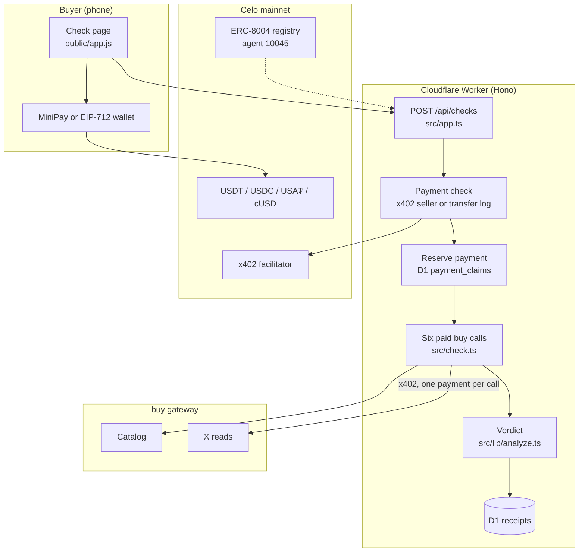
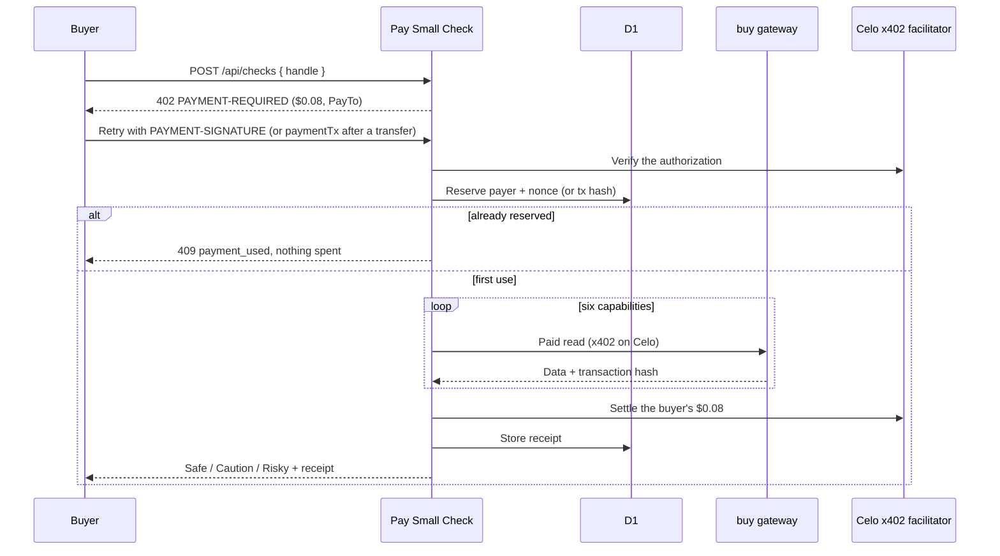
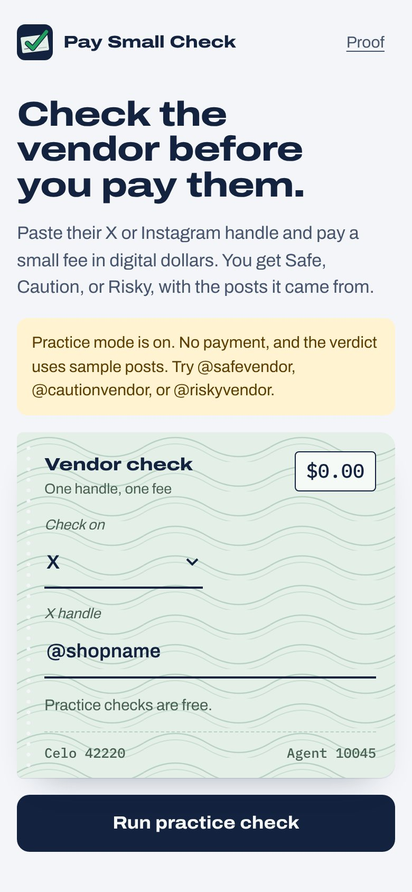
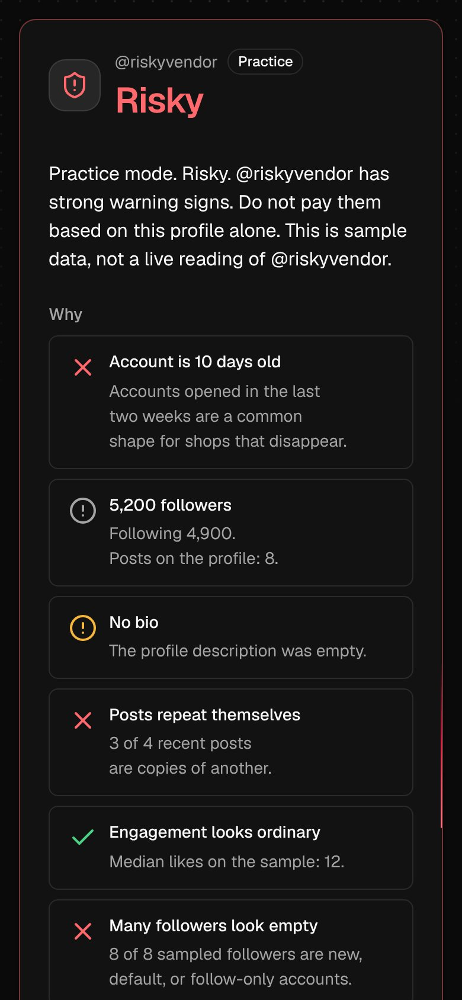
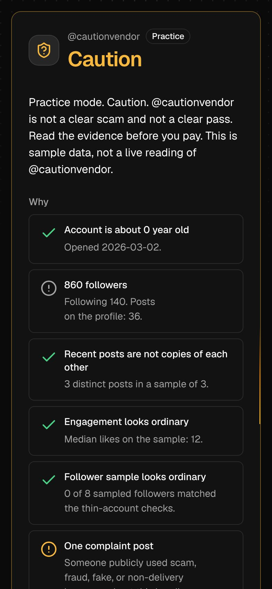
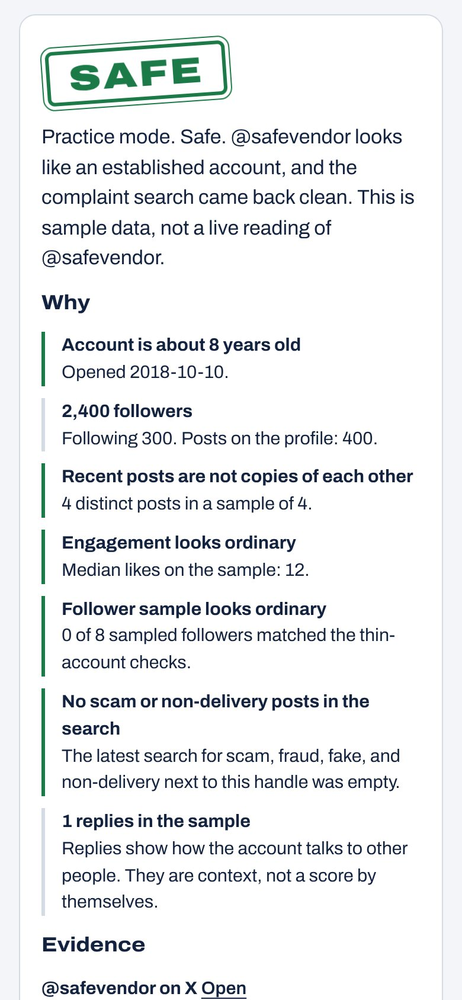
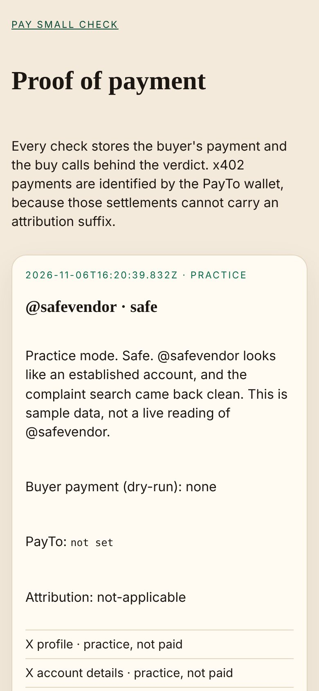
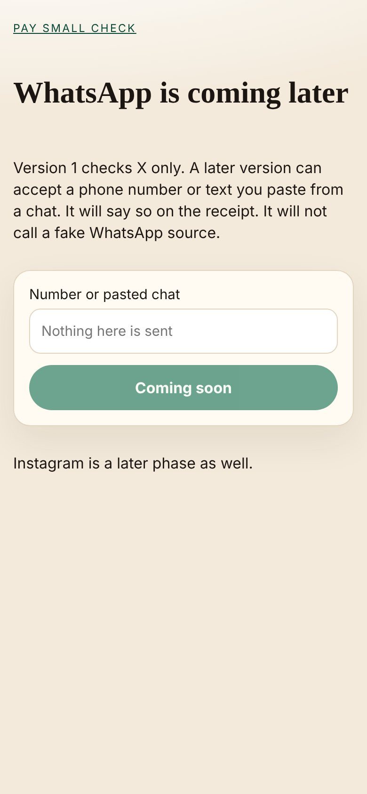

<div align="center">


### Check the vendor on X before you send the money.

A buyer pastes an X handle and pays **$0.08** on Celo. The agent spends it on six paid reads from [buy](https://usebuy.ai) and returns **Safe**, **Caution**, or **Risky**, with the posts the verdict came from.

[](https://pay-small-check.ahmardchain.workers.dev)
[](https://pay-small-check.ahmardchain.workers.dev/proof/)
[](https://x.com/ahmardchain)

[](https://github.com/ahmardchain/pay-small-check/actions/workflows/test.yml)
[](https://celoscan.io)
[](https://x402.celo.org)
[](https://usebuy.ai)
[](https://celoscan.io/tx/0x56926cb9a3faba200070350065c04ba7ec0ae2378670428b6df95ea2a940f9c6)
[](https://workers.cloudflare.com)
[](LICENSE)

</div>

| | |
|---|---|
| **Live app** | https://pay-small-check.ahmardchain.workers.dev |
| **Proof** | https://pay-small-check.ahmardchain.workers.dev/proof/ |
| **Judge run-through** | [JUDGES.md](JUDGES.md) |
| **Registration file** | https://pay-small-check.ahmardchain.workers.dev/agent.json |
| **Source** | https://github.com/ahmardchain/pay-small-check |
| **Network** | Celo mainnet, `eip155:42220` |
| **ERC-8004 agent** | **10045**, minted in [`0x56926cb9…40f9c6`](https://celoscan.io/tx/0x56926cb9a3faba200070350065c04ba7ec0ae2378670428b6df95ea2a940f9c6) |
| **PayTo / agent wallet** | [`0x8e23e92f0ec2bd6B8D004Bc913C17AE412322d08`](https://celoscan.io/address/0x8e23e92f0ec2bd6B8D004Bc913C17AE412322d08) |
| **ERC-8021 code** | `celo_aac08e9358f3` |
| **Buyer price** | **$0.08** (USDT, USDC, or USA₮ over x402; USDT or cUSD by transfer) |
| **Stack** | Cloudflare Workers, Hono, D1, viem, `@x402/*`, `@celo/attribution-tags` |

Built for [**Agents on Open Rails**](https://www.loops.house/agents-on-open-rails) (deadline Mon 9 Nov 2026, 09:00 GMT). Track: **Build with buy**.

## Verify in 60 seconds

No wallet and no spend. Checked against the live deployment on 6 Nov 2026.

1. Open the app: https://pay-small-check.ahmardchain.workers.dev
2. Open the public config: https://pay-small-check.ahmardchain.workers.dev/api/config. `dryRun` is `false`, `priceUsd` is `"0.08"`, `payTo` and `agentPayer` are `0x8e23e92f0ec2bd6B8D004Bc913C17AE412322d08`, `agentId` is `"10045"`, and six calls are listed.
3. Open the registration file: https://pay-small-check.ahmardchain.workers.dev/agent.json. Agent id **10045**, wallet `eip155:42220:0x8e23e92f0ec2bd6B8D004Bc913C17AE412322d08`, code `celo_aac08e9358f3`.
4. Open the registration transaction: https://celoscan.io/tx/0x56926cb9a3faba200070350065c04ba7ec0ae2378670428b6df95ea2a940f9c6. Status success, `register` on the Identity Registry, ERC-721 token id **10045** minted to the agent wallet. The input data ends with the attribution tag: the hex of `celo_aac08e9358f3`, then length `11`, schema `00`, then the `8021` marker repeated.

   ```text
   63656c6f5f616163303865393335386633110080218021802180218021802180218021
   ```

5. Open the proof page: https://pay-small-check.ahmardchain.workers.dev/proof/. Every paid check is listed with its Celoscan links.
6. Ask for a check without paying. This returns HTTP 402 with a `PAYMENT-REQUIRED` header (x402 version 2, three accepts, each `80000` on `eip155:42220`, PayTo the agent wallet). It does not settle.

   ```bash
   curl -i -X POST https://pay-small-check.ahmardchain.workers.dev/api/checks \
     -H 'content-type: application/json' -H 'accept: application/json' \
     -d '{"handle":"celo"}'
   ```

## Why it exists

The [Global State of Scams 2025](https://gasa.org/knowledge-base/blog/global-scams-on-the-rise-over-half-of-adults-worldwide-report-scam-encounters) report by the Global Anti-Scam Alliance and Feedzai surveyed 46,000 adults in 42 markets. 57% met a scam in the past year and 23% lost money, roughly [$442 billion in total](https://www.feedzai.com/blog/gasa-global-state-of-scams-report/). Shopping and purchase scams were the most common kind: 54% of victims were hit by one.

Paying a vendor from X is usually a scroll and a hope. The complaints ("scam", "didn't deliver", "fake") sit in replies and mentions, and a new account with a bought following looks the same as a shop that has delivered for years.

1. **The check is manual.** Account age, follower quality, repeated posts, and complaint language are not on the first screen.
2. **The data is not ours.** Profile, posts, replies, followers, and search are bought per call from the buy gateway. This app holds no X API key.
3. **The result has to be checkable.** A verdict is useless if nobody can open the payment behind it. Every paid check is stored on `/proof`.

Pay Small Check does that reading for eight cents, before the money moves.

- ✅ Safe, Caution, or Risky, with the reason and the post behind every signal
- ✅ Six real paid reads per check, each its own x402 payment on Celo
- ✅ Pays from MiniPay (stablecoin transfer, fee in the same coin) or any wallet that signs typed data (gasless x402)
- ✅ A public receipt for every check, with the buyer's payment and every buy transaction
- ✅ One payment buys exactly one check, even under parallel replays

## Demo flow (90 seconds)

1. Open https://pay-small-check.ahmardchain.workers.dev on a phone or a narrow window.
2. Paste an X handle. The field accepts `@name` or `name`.
3. Choose USDT or cUSD. The fee shown is $0.08.
4. Pay. In MiniPay that is a stablecoin transfer and the network fee comes out of the same coin. In a wallet that can sign typed data, USDT can be a gasless x402 signature. cUSD is always a transfer.
5. Wait. The agent buys six X reads from buy, then the page stamps **Safe**, **Caution**, or **Risky**, with the reasons and links.
6. Open **Open the public receipt**. That is `/proof/?id=…`. The same row is on https://pay-small-check.ahmardchain.workers.dev/proof/.

The video storyboard is in [DEMO-SCRIPT.md](DEMO-SCRIPT.md).

## Table of contents

- [Core features](#core-features)
- [How buy and Celo are used](#how-buy-and-celo-are-used)
- [Architecture](#architecture)
- [Live proof](#live-proof)
- [Key design decision: one payment, one check](#key-design-decision-one-payment-one-check)
- [Screenshots](#screenshots)
- [What's real vs. mock](#whats-real-vs-mock)
- [Hackathon criteria](#hackathon-criteria)
- [Tech stack](#tech-stack)
- [Getting started](#getting-started)
- [Environment variables](#environment-variables)
- [API reference](#api-reference)
- [Project structure](#project-structure)
- [Known limits](#known-limits)
- [Roadmap](#roadmap)
- [Builder](#builder)

## Core features

### 🔎 Six paid reads per check

| # | What it is for | Capability | Endpoint |
|---|---|---|---|
| 1 | Account age, counts, bio, verification | `monid.x.tikhub.api-v1-twitter-web-fetch-user-profile` | [`POST /v1/social/x/tools/tikhub-api-v1-twitter-web-fetch-user-profile`](https://gateway.usebuy.ai/v1/social/x/tools/tikhub-api-v1-twitter-web-fetch-user-profile) |
| 2 | About card | `monid.x.tikhub.api-v1-twitter-web-fetch-user-about` | [`POST /v1/social/x/tools/tikhub-api-v1-twitter-web-fetch-user-about`](https://gateway.usebuy.ai/v1/social/x/tools/tikhub-api-v1-twitter-web-fetch-user-about) |
| 3 | Recent posts, repetition, engagement | `monid.x.tikhub.api-v1-twitter-web-fetch-user-post-tweet` | [`POST /v1/social/x/tools/tikhub-api-v1-twitter-web-fetch-user-post-tweet`](https://gateway.usebuy.ai/v1/social/x/tools/tikhub-api-v1-twitter-web-fetch-user-post-tweet) |
| 4 | Replies | `monid.x.tikhub.api-v1-twitter-web-fetch-user-tweet-replies` | [`POST /v1/social/x/tools/tikhub-api-v1-twitter-web-fetch-user-tweet-replies`](https://gateway.usebuy.ai/v1/social/x/tools/tikhub-api-v1-twitter-web-fetch-user-tweet-replies) |
| 5 | A page of followers | `monid.x.tikhub.api-v1-twitter-web-fetch-user-followers` | [`POST /v1/social/x/tools/tikhub-api-v1-twitter-web-fetch-user-followers`](https://gateway.usebuy.ai/v1/social/x/tools/tikhub-api-v1-twitter-web-fetch-user-followers) |
| 6 | Posts saying scam, fraud, fake, didn't deliver, no refund | `x.posts.search` | [`POST /v1/social/x/posts/search`](https://gateway.usebuy.ai/v1/social/x/posts/search) |

Prices are the catalog quotes read on 6 Nov 2026, about **$0.005** each in USDC, USDT, or USAT. The live catalog at `GET https://gateway.usebuy.ai/v1/catalog` is re-read per check and is the authority at request time.

### 🧾 A verdict you can argue with

[`src/lib/analyze.ts`](src/lib/analyze.ts) scores what came back and shows every signal with its evidence.

| Verdict | When |
|---|---|
| **Risky** | Three or more complaint posts, or an account under 30 days old with any complaint, or several warning signs together (new account, repeated posts, thin followers) |
| **Caution** | Some warning signs, or the complaint search could not be read |
| **Safe** | An ordinary account and a clean complaint search |

A missing or unreadable complaint search can never come back Safe.

### 💳 Two ways to pay

| Rail | Who it is for | Asset | Amount |
|---|---|---|---|
| x402, gasless | Wallets that can sign EIP-712 | USDT, USDC, or USA₮ | `80000` (6 decimals) = $0.08 |
| Transfer | MiniPay, and cUSD | USDT or cUSD (USDm in MiniPay) | $0.08. cUSD is `80000000000000000` (18 decimals) |

MiniPay does not sign the x402 typed-data payload, so the page sends a normal transfer and pays the network fee in that same stablecoin. The hosted facilitator at `https://api.x402.celo.org` does **not** settle cUSD. Gasless signatures are USDT (`Tether USD`, version `1`), USDC (`USDC`, version `2`), or USA₮ (`Tether America USD`, version `1`).

### 📜 Public receipts

[`/proof`](https://pay-small-check.ahmardchain.workers.dev/proof/) lists every check. Each receipt has the verdict, evidence links, the buyer's payment transaction, PayTo, whether attribution was the ERC-8021 code or the PayTo address, and one row per buy call (capability, URL, transaction hash, correlation id).

## How buy and Celo are used

| Piece | What happens | When | Code |
|---|---|---|---|
| buy catalog | `GET /v1/catalog` resolves the six capabilities, URLs, and quotes | Every check (cached 10 min) | [`src/lib/catalog.ts`](src/lib/catalog.ts), [`src/lib/capabilities.ts`](src/lib/capabilities.ts) |
| buy paid calls | `@x402/fetch` pays each call from the agent wallet; gateway PayTo `0x20faAca5F980E29639A0FCC6dcA6988E18ed333B` | Six times per check | [`src/lib/buy.ts`](src/lib/buy.ts), [`src/check.ts`](src/check.ts) |
| Celo x402 facilitator | Verifies and settles the buyer's gasless authorization | Once per x402 check | [`src/x402-seller.ts`](src/x402-seller.ts) |
| Celo RPC | Reads a transfer's receipt and `Transfer` log to confirm the exact fee reached PayTo | Once per transfer check | [`src/lib/payments.ts`](src/lib/payments.ts) |
| ERC-8004 | Agent 10045 registered from the agent wallet | Once, already mined | [`scripts/register-8004.ts`](scripts/register-8004.ts), [`src/agent-card.ts`](src/agent-card.ts) |
| ERC-8021 | `celo_aac08e9358f3` appended to registration and MiniPay transfer calldata | Every tagged transaction | [`src/lib/attribution.ts`](src/lib/attribution.ts), [`public/app.js`](public/app.js) |

Engineering notes:

- A buy quote above `MAX_BUY_ATOMIC_PER_CALL` (default $0.02) is refused before it is signed. Only the configured token on Celo mainnet is accepted.
- A call that times out or returns `settle_uncertain` is not retried and stops the rest of the queue, so an unknown settlement is never paid twice.
- x402 settlements are submitted by the facilitator and cannot carry an ERC-8021 suffix. Those payments are identified by PayTo `0x8e23e92f0ec2bd6B8D004Bc913C17AE412322d08`.

## Architecture





## Live proof

| | |
|---|---|
| Chain | Celo mainnet, chain id `42220` |
| Identity Registry | [`0x8004A169FB4a3325136EB29fA0ceB6D2e539a432`](https://celoscan.io/address/0x8004A169FB4a3325136EB29fA0ceB6D2e539a432) |
| Agent id | **10045** |
| Registration | [`0x56926cb9a3faba200070350065c04ba7ec0ae2378670428b6df95ea2a940f9c6`](https://celoscan.io/tx/0x56926cb9a3faba200070350065c04ba7ec0ae2378670428b6df95ea2a940f9c6), success, 6 Nov 2026, `register(agentURI)`, gas paid in USDT |
| Agent URI | https://pay-small-check.ahmardchain.workers.dev/agent.json |
| Owner / agent wallet / PayTo | [`0x8e23e92f0ec2bd6B8D004Bc913C17AE412322d08`](https://celoscan.io/address/0x8e23e92f0ec2bd6B8D004Bc913C17AE412322d08) |
| buy gateway PayTo | [`0x20faAca5F980E29639A0FCC6dcA6988E18ed333B`](https://celoscan.io/address/0x20faAca5F980E29639A0FCC6dcA6988E18ed333B) |
| Calldata suffix | `celo_aac08e9358f3`, then `0x11 0x00`, then the ERC-8021 marker |
| Paid checks | Live list on [/proof](https://pay-small-check.ahmardchain.workers.dev/proof/) and [/api/receipts](https://pay-small-check.ahmardchain.workers.dev/api/receipts) |

The registration file the transaction points at is live and lists the same wallet, the same code, and `registrations[].agentId = 10045`.

## Key design decision: one payment, one check

Every check spends real money on six buy calls. The payment that funds it has to be impossible to reuse.

The naive version fails in two ways:

- ❌ **Check, then spend, then record.** A transfer hash checked for reuse before the buy calls, and only made unique when the receipt is saved after them, lets ten parallel requests with one hash all pass the check. Each spends about $0.03.
- ❌ **Verify, then spend, then settle.** x402 verification does not use up the authorization's nonce; only settlement does. Parallel requests with one signature all verify, and all buy.

So the payment is reserved **before** the first paid call, with an atomic insert on a primary key in D1. Only one request can win. The reservation is released only when a check charged nothing, so a failed check can still be retried with the same payment.

```ts
// src/app.ts (x402 rail; the transfer rail uses `transfer:<hash>`)
const claimKey = x402ClaimKey(result.paymentPayload, c.req.raw); // payer + EIP-3009 nonce
if (!(await store.claimPayment(claimKey))) {
  return c.json({ error: "payment_used", message: "That payment authorization is already being used for a check." }, 409);
}
const live = await runLiveCheck(settings, handle, options.fetchImpl);
if (!live.charge || !live.analysis) {
  await store.releasePayment(claimKey); // nothing was spent, so allow a retry
  // ...return 502 check_failed
}
```

```sql
-- migrations/0002_payment_claims.sql
CREATE TABLE IF NOT EXISTS payment_claims (key TEXT PRIMARY KEY, created_at TEXT NOT NULL);
-- claimPayment runs INSERT OR IGNORE and wins only when meta.changes === 1
```

[`test/replay.test.ts`](test/replay.test.ts) fires five parallel replays on each rail and asserts exactly six paid calls and one settlement.

## Screenshots

Captured from a local run in practice mode (`DRY_RUN=true`, sample posts, no payment). The live site serves the same pages with real payments and real reads.

| | |
|---|---|
| <br/>**Paste a handle, see the fee** | <br/>**Risky, with every reason** |
| <br/>**Caution: read before you pay** | <br/>**Safe: an ordinary account, clean search** |
| <br/>**Public receipts on /proof** | <br/>**WhatsApp is labeled coming soon, not faked** |

## What's real vs. mock

| Piece | State |
|---|---|
| Live site `dryRun: false`, price $0.08, PayTo, agent 10045 | ✅ Real. Read them on [/api/config](https://pay-small-check.ahmardchain.workers.dev/api/config) |
| ERC-8004 registration, agent 10045, tag in the calldata | ✅ Real. [Transaction](https://celoscan.io/tx/0x56926cb9a3faba200070350065c04ba7ec0ae2378670428b6df95ea2a940f9c6) |
| Unpaid `POST /api/checks` → 402 `PAYMENT-REQUIRED` for USDT, USDC, USA₮ | ✅ Real. Curl above |
| Six buy routes (profile, about, posts, replies, followers, complaint search) | ✅ Real endpoints on `gateway.usebuy.ai`, each quoted at $0.005 on 6 Nov 2026. A live check pays them |
| Buyer payments and buy transaction hashes on `/proof` | ✅ Real. Rows appear only when a buyer pays; no count is typed into this README |
| Verdict rules, payment checks, receipts, replay protection | 🛠️ Self-built in this repo |
| `@safevendor`, `@cautionvendor`, `@riskyvendor` | 🧪 Sample posts, labeled practice. Only when `DRY_RUN=true` (the local default in `wrangler.jsonc`). Never on the live site |
| WhatsApp | ⏸️ Coming-soon page at `/whatsapp/`. The field is disabled. Nothing is uploaded. No WhatsApp data source |
| Instagram | ⏸️ Not built. A later phase |
| A guarantee the vendor will deliver | Not what this is. The verdict is a reading of public posts |

## Hackathon criteria

**Build with buy** is judged on the problem solved and the depth of integration.

| Criterion | How it is met |
|---|---|
| Problem solved | A buyer about to pay a vendor they only know from X gets Safe, Caution, or Risky with links before that payment. See [Why it exists](#why-it-exists) |
| Depth of integration: verified paid calls into services this project does not control | One check buys six different capabilities from the [buy gateway](https://gateway.usebuy.ai/v1/catalog). Each is its own x402 payment on Celo to the gateway's PayTo, not this app |
| Growth for those services | Six calls per check, about $0.03 of catalog price at the 6 Nov 2026 quotes, not one repeated cheap call. Every buyer fee turns into paid demand for buy |
| Independent users are a qualifier | Any existing Celo wallet can pay, by MiniPay transfer or x402 signature. Each paid check links its buyer transaction on [/proof](https://pay-small-check.ahmardchain.workers.dev/proof/) |
| Proof of payment | Each receipt stores the buyer transaction and every buy transaction hash |

General rules:

| Rule | Status | Proof |
|---|---|---|
| Celo mainnet only | ✅ | Chain 42220 on [/api/config](https://pay-small-check.ahmardchain.workers.dev/api/config) |
| Public GitHub repo | ✅ | This repository |
| ERC-8004 identity from the agent wallet | ✅ | Agent **10045**, registry `eip155:42220:0x8004A169FB4a3325136EB29fA0ceB6D2e539a432` |
| Attribution tag implemented | ✅ | `celo_aac08e9358f3` on the registration calldata and appended to MiniPay transfers |
| PayTo for x402 | ✅ | `0x8e23e92f0ec2bd6B8D004Bc913C17AE412322d08`, also `payTo` on the live 402 |
| Sponsored gas disclosed | ✅ | No relayer pays gas for users. MiniPay pays the fee in the transfer's stablecoin; x402 settlements are submitted by the Celo facilitator |
| Code written during the hackathon | ✅ | See [AI usage and prior work](#ai-usage-and-prior-work) |

Copy-paste form answers are in [SUBMISSION.md](SUBMISSION.md).

## Tech stack

| Layer | Choice |
|---|---|
| Runtime | Cloudflare Workers (Standard usage model), static pages from `public/` |
| HTTP | Hono 4 |
| Storage | Cloudflare D1: `receipts`, `payment_claims` |
| Chain | viem on Celo mainnet (`forno.celo.org`) |
| Payments | `@x402/core`, `@x402/evm`, `@x402/fetch`, `@x402/hono`; Celo hosted facilitator |
| Data | buy gateway (`gateway.usebuy.ai`) |
| Attribution | `@celo/attribution-tags` (ERC-8021) |
| Identity | ERC-8004 Identity Registry |
| Language and tests | TypeScript 5, `node:test` via `tsx`, GitHub Actions |

## Getting started

Prerequisites: Node 20 or newer, npm, and a Cloudflare account for deploys.

```bash
git clone https://github.com/ahmardchain/pay-small-check.git
cd pay-small-check
npm install
npm test
npm run check:dry -- @riskyvendor
```

A local checkout spends nothing until `DRY_RUN` is `false` and the secrets exist. `wrangler.jsonc` ships with `DRY_RUN=true`, so `npm run dev` stamps a verdict from sample posts and says so. Practice handles: `@safevendor`, `@cautionvendor`, `@riskyvendor`.

| Command | What it does | Spends? |
|---|---|---|
| `npm test` | 27 tests: verdicts, catalog plan, ERC-8021 round-trip, x402 challenge, transfer receipt, parallel payment replays on both rails. The x402 challenge test calls the hosted facilitator, so it needs network | No |
| `npm run typecheck` | `tsc --noEmit` | No |
| `npm run check:dry -- @handle` | Prints a practice verdict | No |
| `npm run db:migrate:local` | Applies D1 migrations to the local database | No |
| `npm run dev` | Worker on localhost. Practice mode unless `DRY_RUN=false` | No, while `DRY_RUN=true` |
| `npm run register:8004 -- --dry-run` | Prints the tagged `register` transaction. Already broadcast; see the tx above | No |
| `npm run db:migrate` | Applies D1 migrations to the remote database | No |
| `npm run deploy` | Deploys to Cloudflare Workers | Deploy only |

To take live payments from a fresh deploy:

1. Set `AGENT_PRIVATE_KEY` for `0x8e23e92f0ec2bd6B8D004Bc913C17AE412322d08` as a Wrangler secret. The key is not in this repo.
2. Set `X402_API_KEY` from [x402.celo.org](https://x402.celo.org) as a Wrangler secret.
3. Set `DRY_RUN=false` and `AGENT_ID=10045`.
4. Create the D1 database and run `npm run db:migrate` before every deploy that adds a migration.
5. Fund the wallet with USDT (or USDC / USAT if `BUY_TOKEN` changes). About $0.03 of the $0.08 fee is the six data calls at the 6 Nov catalog quotes.
6. Run `npm run deploy`.

## Environment variables

Copy [`.env.example`](.env.example) to `.dev.vars` for local runs. Vars in `wrangler.jsonc` are public; secrets go in `.dev.vars` or `wrangler secret put`.

**Required for live checks**

| Variable | What it is |
|---|---|
| `DRY_RUN` | `false` to take real payments. Anything else is practice mode |
| `AGENT_PRIVATE_KEY` | Secret. Key of the agent wallet that pays buy |
| `PAY_TO` | Where the buyer's fee goes. Defaults to the agent wallet |
| `X402_API_KEY` | Secret. Celo facilitator key, needed to settle x402 buyer payments. Transfers do not need it |

**Optional**

| Variable | Default | What it is |
|---|---|---|
| `CHECK_PRICE_USD` | `0.08` | What the buyer pays for one check |
| `BUY_TOKEN` | `USDT` | Token the agent spends at buy: `USDC`, `USDT`, or `USAT` |
| `MAX_BUY_ATOMIC_PER_CALL` | `20000` | Per-call cap in 6-decimal units ($0.02) |
| `ATTRIBUTION_CODE` | `celo_aac08e9358f3` | ERC-8021 builder code |
| `AGENT_ID` | empty | ERC-8004 agent id for `agent.json` |
| `PUBLIC_APP_URL` | request origin | Public origin used in `agent.json` |
| `CELO_RPC_URL` | `https://forno.celo.org` | Celo mainnet RPC |
| `BUY_GATEWAY_CATALOG` | `https://gateway.usebuy.ai/v1/catalog` | buy catalog |
| `X402_FACILITATOR_URL` | `https://api.x402.celo.org` | Celo x402 facilitator |
| `GITHUB_REPO` | `ahmardchain/pay-small-check` | Used for the support link |

## API reference

| Method | Route | Description |
|---|---|---|
| `POST` | `/api/checks` | Run a check. Body `{ "handle": "@name" }`. Unpaid returns `402` with `PAYMENT-REQUIRED`. Retry with `PAYMENT-SIGNATURE`, or with `{ "handle", "paymentTx": "0x…", "token": "USDT" or "cUSD" }` after a transfer. A reused payment returns `409`. `channel: "whatsapp"` or `"instagram"` returns `501` |
| `GET` | `/api/receipts` | Latest public receipts, `?limit=` up to 100 |
| `GET` | `/api/receipts/:id` | One receipt |
| `GET` | `/api/config` | Public config: price, PayTo, tokens, agent id, the six calls |
| `GET` | `/api/health` | Liveness and `dryRun` |
| `GET` | `/agent.json` | ERC-8004 registration file (also `/.well-known/agent-registration.json`) |

## Project structure

```text
pay-small-check/
├── public/                    # mobile pages: check, /proof, /how-to, /about, /whatsapp stub, terms, privacy, support
├── src/
│   ├── app.ts                 # HTTP API, both payment rails, payment reservation
│   ├── check.ts               # catalog, then the six paid calls
│   ├── x402-seller.ts         # buyer fee via https://api.x402.celo.org
│   ├── agent-card.ts          # ERC-8004 registration file
│   ├── settings.ts            # env parsing and live-mode guards
│   └── lib/
│       ├── buy.ts             # @x402/fetch buyer, Celo mainnet, per-call cap
│       ├── analyze.ts         # Safe / Caution / Risky
│       ├── payments.ts        # transfer verification from the Transfer log
│       ├── receipts.ts        # D1 receipts and payment claims
│       └── attribution.ts     # ERC-8021 suffix
├── migrations/                # D1 receipts and payment reservations
├── scripts/                   # register-8004.ts, dry-run-check.ts
├── test/                      # node:test suites, including replay.test.ts
├── docs/                      # logo and screenshots
├── JUDGES.md                  # 90-second judge run-through
├── SUBMISSION.md              # form answers and rules checklist
├── DEMO-SCRIPT.md             # video storyboard
├── X-POST.md                  # launch posts
└── CHANGELOG.md
```

## Known limits

- Version 1 reads X only. The WhatsApp page does not submit. Instagram is not wired.
- cUSD cannot be an x402 payment on the hosted facilitator. It is a transfer.
- x402 payments do not carry `celo_aac08e9358f3`. Use the PayTo address for those.
- The complaint-search payload is whatever the gateway returns. A shape this app cannot read is a gap, not a clean bill of health.
- A paid call is not automatically repeated after a timeout or `settle_uncertain`.
- A transfer is not bound to the person who sent it. Whoever submits a matching transaction hash first gets the check.

## Roadmap

- **WhatsApp:** the buyer pastes the vendor's number or chat text themselves, once there is a data source the agent can actually pay for.
- **Instagram:** the same six-read check, if buy lists Instagram capabilities.
- **Bind transfers to their sender:** have the buyer sign the handle with the paying wallet, so a transfer hash cannot be claimed by someone else.
- **Shareable verdicts:** a link a buyer can drop in the vendor's replies.

## AI usage and prior work

This project was written during Agents on Open Rails with AI coding assistance. There was no prior product code. The repository started from the MIT license.

## Builder

Built by **AHMARD**.

- X: [@ahmardchain](https://x.com/ahmardchain)
- Telegram: [@ahmardchain](https://t.me/ahmardchain)
- GitHub: [ahmardchain](https://github.com/ahmardchain)

---

<div align="center">


A verdict is a reading of public posts, not a promise that a vendor will deliver.

**Check the vendor before you pay.**

MIT. See [LICENSE](LICENSE).

</div>
